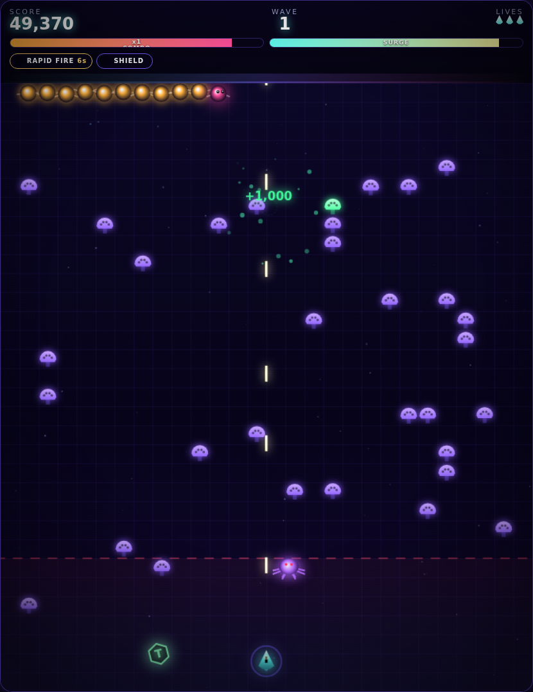

# Neon Centipede

A modern, synthwave-flavoured take on the 1981 arcade classic. Vanilla JavaScript,
one `<canvas>`, zero dependencies, zero build step — the whole thing is static files.



## Play it

```bash
npm start          # serves on http://localhost:8080
```

Or point any static file server at the repo root. (ES modules need `http://`, so
opening `index.html` straight off the filesystem won't work.)

## Controls

| Action | Keyboard | Gamepad | Touch |
| --- | --- | --- | --- |
| Move | `WASD` / arrows | left stick / d-pad | drag anywhere on the field |
| Fire | auto-fire, or `J` / `Z` | `RT` / `X` | automatic |
| Dash | `Space` | `A` | DASH button |
| Surge | `Shift` / `E` | `B` | SURGE button |
| Pause | `Esc` / `P` | `Start` | II button |

## The classic rules, kept

- You are locked to the glowing band at the bottom of the screen.
- Shooting a middle segment **splits** the centipede; every split grows a new head,
  and shorter chains move faster.
- Mushrooms take four shots, and they block the swarm and you — the field is terrain.
- **Fleas** drop when your band gets too clear and plant fresh mushrooms on the way
  down. **Spiders** zigzag through your band and eat mushrooms. **Scorpions** poison
  mushrooms, and a poisoned mushroom makes segments plunge straight at you.
- Losing a life heals the whole field, exactly like the cabinet.

## What's new

- **Combo multiplier** — chained kills build up to `x8` score. Getting hit resets it.
- **Surge mode** — kills charge a meter; spend it for six seconds of double score,
  piercing rounds, faster fire and slowed-down enemies.
- **Dash** — a short burst of speed with brief invulnerability, on a cooldown.
- **Seven power-ups** — rapid fire, wide shot, piercer, shield, time warp, spore bomb
  and (rarely) an extra life. They drift toward you once you're close.
- **The Hive Queen** — every fifth wave is a boss with three phases, a trailing
  armoured body, aimed volleys, minion waves and a phase-three dive attack.
- **Three difficulties** — Chill, Classic and Insane, each with its own score weighting.
- **Local leaderboard** — top ten runs with initials, plus per-run accuracy, best combo
  and kill count.
- **Procedural audio** — every sound effect and the whole soundtrack are synthesised at
  runtime with the Web Audio API. No audio files, no loading screen; the music's tempo
  and brightness scale with the wave.
- **Presentation** — CRT scanlines, screen shake, hit-stop freeze frames, particle
  bursts, floating score text and neon bloom, all toggleable in settings.
- **Plays everywhere** — keyboard, gamepad and touch, with a responsive layout that
  moves the controls below the playfield on phones.

## Layout

```
index.html          markup: canvas, HUD, and all the menu screens
styles.css          neon UI, CRT overlay, responsive layout
src/config.js       grid size, colours, difficulty tables, score and power-up tables
src/main.js         entry point: settings, screens, HUD binding, leaderboard
src/game.js         the orchestrator: waves, scoring, collisions, rendering order
src/field.js        the mushroom field (grid + poison + collision queries)
src/centipede.js    chained follow-the-leader segments, turn rules, splitting
src/enemies.js      spider, flea, scorpion
src/boss.js         the Hive Queen
src/player.js       movement, dash, firing
src/bullets.js      player and enemy projectiles
src/powerups.js     drops and pickup behaviour
src/particles.js    particle system, floating text, screen shake
src/audio.js        Web Audio synth: sound effects and the sequenced soundtrack
src/input.js        keyboard, pointer/touch and gamepad input
src/storage.js      settings and leaderboard persistence (localStorage)
tools/serve.mjs     the little static server behind `npm start`
```

The playfield is a 28 x 32 grid of 24px cells. Grid space is used for the mushroom
field and the centipede's stepping rules; everything else (player, bullets, enemies,
the boss, particles) moves in free pixel space. The top 104px of the canvas is a
reserved band that the DOM HUD sits over, so the swarm never fights the score readout
for pixels.

## Notes

- Settings and scores live in `localStorage` and degrade gracefully when storage is
  blocked (private windows).
- Audio initialises on the first user gesture, per browser autoplay policy.
- `window.__game` exposes the live game instance for poking around in the console.
